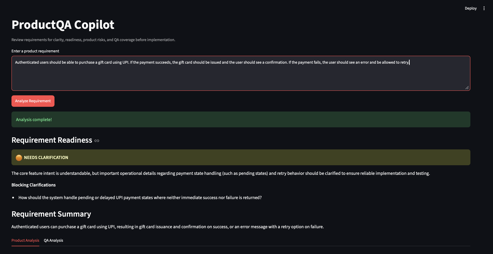
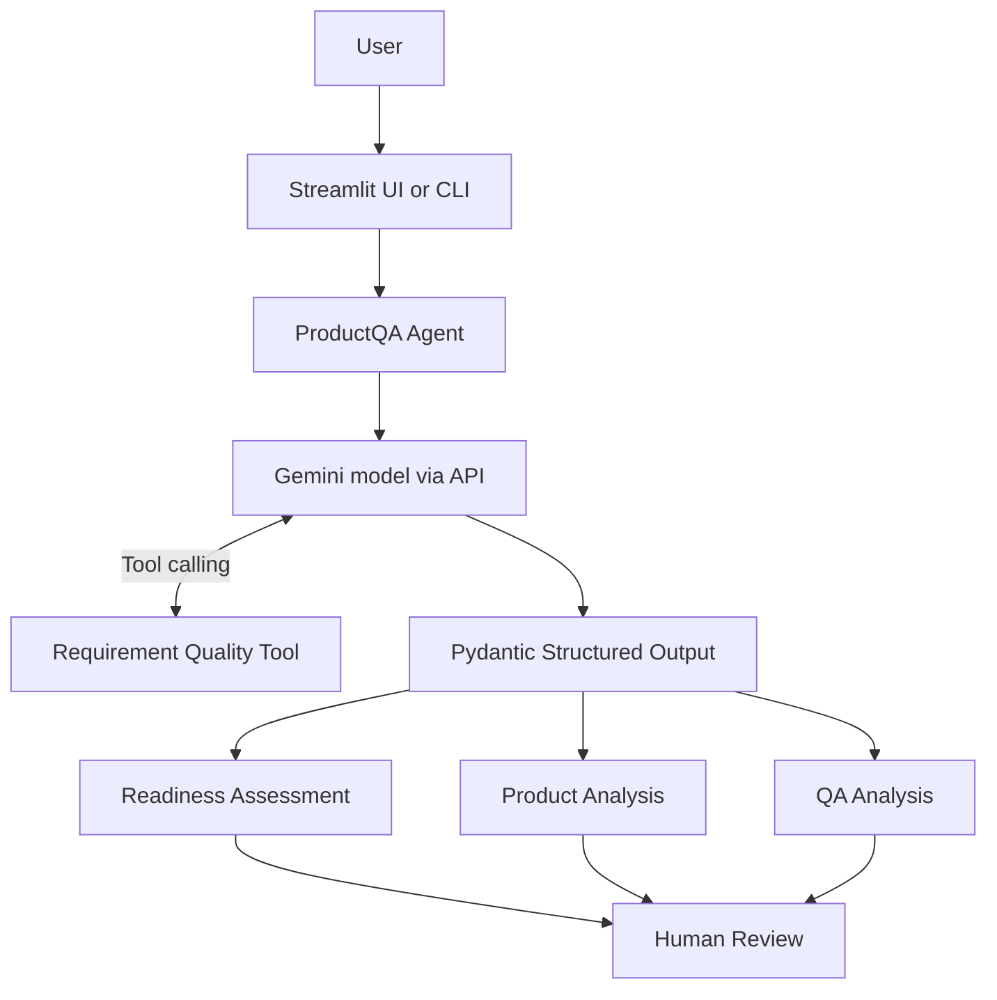
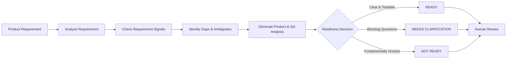

# ProductQA Copilot

**AI-assisted requirement analysis for Product and QA teams.**

ProductQA Copilot reviews product requirements before implementation to surface ambiguities, clarifying questions, user journeys, acceptance-criteria gaps, QA scenarios, technical considerations, and product/quality risks.

It combines LLM reasoning with deterministic requirement-quality checks to produce a structured **Product & QA Readiness Report**. Each report includes a contextual readiness assessment:

- **READY**
- **NEEDS CLARIFICATION**
- **NOT READY**

The goal is to support human decision-making and help Product and QA teams identify important questions earlier in the development lifecycle—not to replace Product, Engineering, or QA judgment.

---

## Product Demo



The example above shows ProductQA identifying a requirement that needs clarification and surfacing the blocking question before implementation.

---

## Problem

Product requirements can reach implementation with unresolved questions around expected behavior, failure states, boundaries, acceptance criteria, or user journeys.

These gaps may surface later during development, QA, or release validation, leading to:

- Rework between Product, Engineering, and QA
- Incomplete or ambiguous acceptance criteria
- Missed edge cases and failure states
- Delayed implementation or testing
- Different interpretations of the same requirement

ProductQA Copilot explores whether an AI-assisted first-pass review can surface these questions earlier while keeping final decisions with human stakeholders.

---

## Solution & Core Features

A user enters a product requirement through the Streamlit interface or command-line application. ProductQA generates:

- **Readiness Assessment** — Classification, reasoning, and blocking clarifications
- **Requirement Summary** — Concise interpretation of the requested behavior
- **Product Analysis** — Gaps, clarifying questions, user journeys, acceptance-criteria assessment, and Product/UX/quality risks
- **QA Analysis** — Positive, negative, boundary, and edge-case scenarios, plus relevant technical considerations
- **Assumptions** — Explicit separation of supplied information from inferred possibilities

The agent also uses a custom deterministic Python tool to detect explicit textual signals related to:

- Failure handling
- Limits and boundaries
- Integrations

These signals support the LLM's contextual assessment. A missing keyword does **not** automatically mean that a requirement is incomplete.

Pydantic defines the structured response format, while application-level error handling manages API and execution failures separately from requirement-quality findings.

---

## Architecture



The Python application coordinates the workflow. The Gemini model provides language reasoning and can invoke the deterministic requirement-quality tool. The final response is validated against the Pydantic schema and displayed through the Streamlit UI or CLI.

---

### Requirement Analysis Flow



## Evaluation Strategy

ProductQA includes an `evaluation.py` suite containing synthetic requirements with different levels and types of ambiguity.

The evaluation set includes examples covering:

- Simple and clearly testable requirements
- Ambiguous payment requirements
- Very vague requirements
- Explicit failure handling
- Transaction boundaries
- Conflicting requirements
- Integration-related wording
- Detailed payment requirements
- Stateful or conditional behavior

For each case, the evaluation script compares **expected vs. actual readiness** and records:

- **PASS** — Expected and actual readiness match
- **FAIL** — Expected and actual readiness differ
- **ERROR** — Analysis could not be completed

Outputs are also reviewed qualitatively for:

- Grounding in the supplied requirement
- Relevance of identified gaps
- Usefulness of clarifying questions
- Separation of blocking and non-blocking questions
- Unsupported assumptions and hallucination control
- QA scenario coverage
- Quality of readiness reasoning

The current evaluation set is exploratory and intentionally not used to claim production-level accuracy.

---

## Evaluation-Driven Iteration

Early evaluation revealed a systematic behavior in the readiness framework: the agent frequently classified otherwise testable requirements as **NEEDS CLARIFICATION** because useful but non-blocking questions were being treated as blockers.

For example, requirements with clearly defined core behavior could still be downgraded because details such as exact UI copy, retry limits, or implementation choices were unspecified.

### Iteration

The readiness decision framework was refined around one question:

> **Can the explicitly requested behavior be implemented and reliably tested without knowing the answer to this clarification?**

If yes, the clarification may still be useful, but it should not automatically block readiness.

The framework was also updated to evaluate readiness against the explicit scope of the requirement rather than expanding that scope with additional policies, edge cases, or implementation decisions.

### Result

After applying the refinement and rerunning the same evaluation cases:

- Previously failing simple UI-copy and explicit transaction-limit examples were correctly classified as **READY**
- Previously passing ambiguous and conflicting examples retained their expected classifications
- Some payment and retry examples remained overly conservative

The remaining behavior is documented as an MVP limitation rather than continuing to tune the system solely to satisfy the small evaluation dataset.

---

## Known Limitations

ProductQA Copilot is an MVP with several known limitations:

- **LLM variability** — Outputs and readiness judgments can differ between runs
- **Over-conservative readiness** — Some useful but non-blocking questions may still be treated as blockers
- **Keyword-matching limitations** — The deterministic tool can produce false positives or miss semantically equivalent wording
- **Limited product context** — The agent does not currently have access to an organization's existing PRDs, business rules, or historical product decisions
- **Potential over-expansion** — Generated analysis may occasionally introduce technical possibilities or surrounding product considerations that were not explicitly provided
- **Limited evaluation coverage** — The current synthetic evaluation set identifies behavioral patterns but does not establish real-world accuracy or reliability
- **External API dependency** — Gemini API availability, service failures, quotas, and rate limits can interrupt analysis

Outputs should therefore be treated as structured decision support rather than an authoritative replacement for human Product, Engineering, or QA review.

---

## Future Roadmap

Potential next iterations include:

- **Document & PRD Context** — Analyze requirements using relevant product documentation and historical context
- **Semantic Requirement Checks** — Supplement keyword matching with context-aware classification
- **Hybrid Readiness Framework** — Combine LLM reasoning with deterministic readiness rules for greater consistency
- **Jira / GitHub Integration** — Bring requirement review closer to existing product-development workflows
- **Expanded Evaluation Suite** — Build a larger regression dataset across requirement types and product domains
- **Retry & Backoff Handling** — Improve resilience to temporary LLM API failures and rate limits
- **Multi-Agent Exploration** — Evaluate whether specialized Product and QA agents improve analysis compared with the current unified agent

---

## Tech Stack

- **Python** — Application logic and agent orchestration
- **Gemini API** — LLM access
- **Google GenAI SDK** — Python SDK for interacting with Gemini
- **Pydantic** — Structured output definition and validation
- **Streamlit** — Browser-based user interface
- **python-dotenv** — Environment variable management
- **Git** — Version control
- **GitHub** — Repository hosting and documentation

The configured Gemini model is defined in `agent.py` and may change as model availability evolves.

---

## Project Structure

```text
productqa-agent/
│
├── agent.py                  # Agent orchestration and Gemini interaction
├── app.py                    # Command-line interface
├── ui.py                     # Streamlit browser interface
├── models.py                 # Pydantic structured-output models
├── evaluation.py             # Agent evaluation suite
├── requirements.txt          # Python dependencies
├── .env.example              # Safe environment configuration example
├── .gitignore                # Files excluded from version control
│
└── tools/
    └── requirement_tools.py  # Deterministic requirement-quality checks
```

---

## Installation

### 1. Clone the repository

```bash
git clone https://github.com/jaishwarya1712-jpg/productqa-copilot.git
cd productqa-copilot
```

### 2. Create a virtual environment

```bash
python3 -m venv .venv
```

### 3. Activate the virtual environment

On macOS/Linux:

```bash
source .venv/bin/activate
```

### 4. Install dependencies

```bash
pip install -r requirements.txt
```

### 5. Configure the Gemini API key

Create a `.env` file in the project root using `.env.example` as a reference:

```text
GEMINI_API_KEY=your_gemini_api_key_here
```

Obtain your own Gemini API key and keep it private.

Never commit `.env` or expose API credentials publicly.

---

## Running the Application

### Browser Interface

```bash
streamlit run ui.py
```

Open the local URL provided by Streamlit in your browser.

### Command-Line Interface

```bash
python app.py
```

The CLI was built first to validate the core agent workflow before adding the browser interface.

### Evaluation Suite

```bash
python evaluation.py
```

The evaluation script makes Gemini API calls and may consume API quota.

---

## Example

### Input Requirement

> Authenticated users should be able to purchase a gift card using UPI. If the payment succeeds, confirm the purchase. If the payment fails, show an error and allow the user to retry.

### Illustrative Readiness

**READY**

The explicitly requested core behavior is sufficiently clear and testable. Additional questions around UI presentation or implementation details may still be useful without necessarily blocking implementation.

ProductQA also returns detailed Product and QA analysis covering requirement gaps, clarifying questions, user journeys, acceptance-criteria assessment, QA scenarios, technical considerations, risks, and assumptions.

Actual model output may vary between runs.

---

## Responsible Use

ProductQA Copilot is an experimental decision-support MVP.

LLM-generated analysis can be incomplete, inconsistent, or incorrect. Product decisions, acceptance criteria, technical decisions, testing decisions, and release readiness should continue to be reviewed by the appropriate human stakeholders.

Use synthetic or non-confidential requirements for experimentation. Do not submit proprietary, sensitive, or confidential product information to external AI services without appropriate authorization.