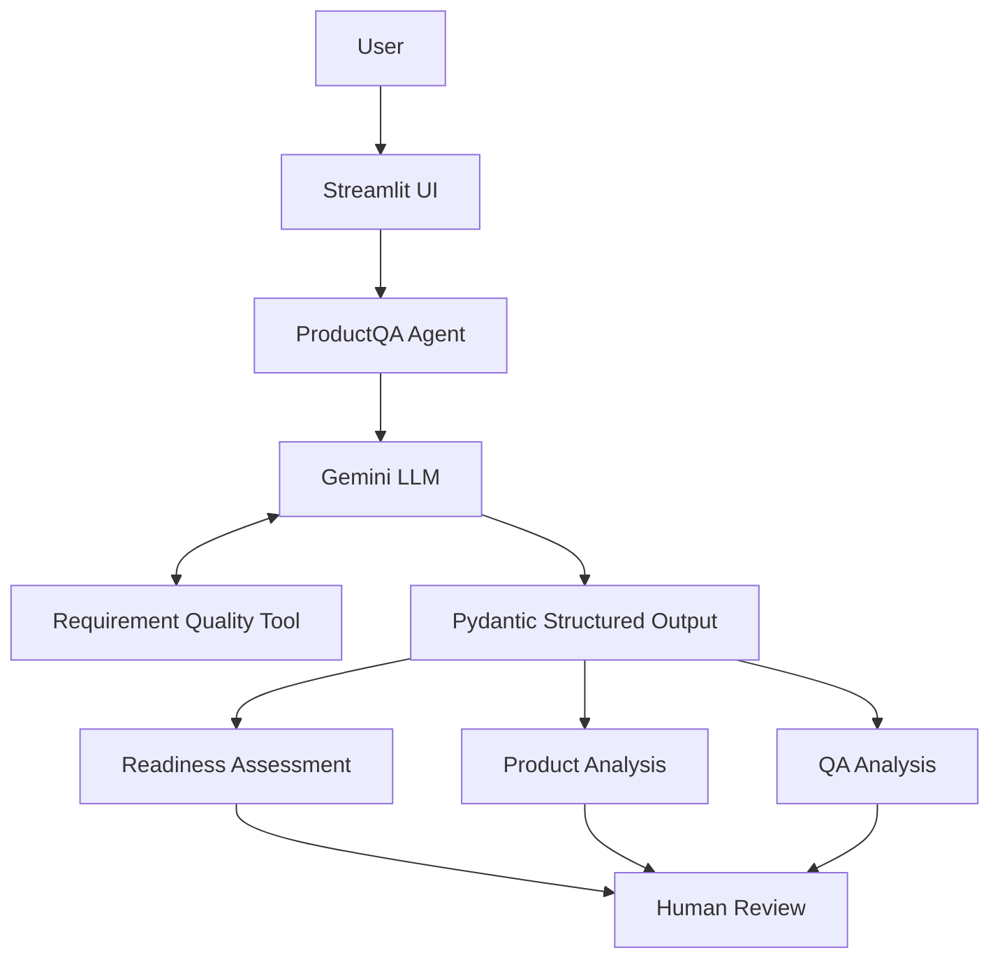

# ProductQA Copilot

**AI-assisted requirement analysis for Product and QA teams.**

ProductQA Copilot is an AI-powered tool that reviews product requirements before implementation and helps identify ambiguities, clarifying questions, user journeys, acceptance-criteria gaps, QA scenarios, technical considerations, and product/quality risks.

It combines LLM reasoning with deterministic requirement-quality checks and produces a structured **Product & QA Readiness Report**, including a readiness assessment:

- **READY**
- **NEEDS CLARIFICATION**
- **NOT READY**

The goal is not to replace Product or QA judgment, but to provide a structured first-pass review that helps teams identify important questions earlier in the development lifecycle.

#  Project introduction ^: explaination for the above : Our evaluation showed the LLM can still occasionally over-analyze or infer surrounding context. So we're positioning it as a decision-support tool with human review, which is both more accurate and more mature from a PM perspective. 

## Problem

Product requirements often move into implementation with unresolved ambiguity around expected behavior, failure states, boundaries, acceptance criteria, or user journeys.

These gaps may surface later during development, QA, or release validation, when resolving them becomes more expensive and can lead to:

- Rework between Product, Engineering, and QA
- Incomplete or ambiguous acceptance criteria
- Missed edge cases and failure states
- Delayed implementation or testing
- Different interpretations of the same requirement

ProductQA Copilot explores whether AI-assisted requirement review can surface these questions earlier, while keeping the final decision with the human Product and QA teams.

# explaination for the above ^: I identified a workflow problem from my Product/QA experience and explored whether an AI-assisted tool could reduce requirement ambiguity before implementation.

## Solution

A user enters a product requirement into ProductQA Copilot.

The system analyzes the requirement from both Product and QA perspectives and returns a structured review covering:

1. Requirement readiness
2. Requirement summary
3. Gaps and ambiguities
4. Clarifying questions
5. User journeys and states
6. Acceptance criteria assessment
7. Positive, negative, boundary, and edge-case QA scenarios
8. Technical considerations
9. Product, UX, and quality risks
10. Assumptions

The readiness framework distinguishes between questions that materially block implementation and useful considerations that are non-blocking.

## Core Features

- **Requirement Readiness Assessment** — Classifies requirements as READY, NEEDS CLARIFICATION, or NOT READY.
- **Product Analysis** — Identifies ambiguity, clarifying questions, user journeys, acceptance-criteria gaps, and product/UX risks.
- **QA Analysis** — Generates positive, negative, boundary, and edge-case scenarios where relevant.
- **Deterministic Requirement Checks** — Uses a custom Python tool to detect explicit textual signals related to failure handling, limits/boundaries, and integrations.
- **Structured AI Output** — Uses Pydantic models to enforce a predictable response structure.
- **Error Handling** — Handles LLM API server, request, quota, and unexpected failures gracefully.
- **Evaluation Suite** — Tests agent behavior across clear, ambiguous, conflicting, and edge-case requirements.
- **Streamlit Interface** — Provides a lightweight browser interface for submitting requirements and reviewing structured Product and QA analysis.

# above has: It has agent instructions, tool calling, schemas, evaluation, error handling, and a user-facing interface.

## Architecture



# What's mermaid? Mermaid lets us describe diagrams using text. GitHub can render supported Mermaid blocks as an actual diagram, so instead of manually drawing boxes in Canva/Figma and maintaining an image, the architecture lives directly in the README.
# One subtle architectural point: our Python application/agent orchestrates this whole workflow. We're not saying Gemini itself is the entire agent.

## Evaluation Strategy

ProductQA Copilot was evaluated using a fixed set of synthetic product requirements representing different levels of requirement quality and ambiguity.

The evaluation set included:

- Simple and clearly testable requirements
- Ambiguous payment requirements
- Very vague requirements
- Requirements with explicit failure handling
- Requirements with explicit transaction boundaries
- Conflicting requirements
- Integration-related wording
- Detailed payment requirements
- Stateful or conditional behavior

For each test case, the evaluation script compares the expected readiness classification with the agent's actual classification and records the result as:

- **PASS** — Expected and actual readiness match
- **FAIL** — Expected and actual readiness differ
- **ERROR** — The analysis could not be completed

In addition to deterministic readiness checks, outputs were reviewed qualitatively for:

- Groundedness in the supplied requirement
- Relevance of identified gaps
- Usefulness of clarifying questions
- Separation of blocking and non-blocking questions
- Hallucination control
- QA scenario coverage
- Quality of readiness reasoning

# Why both deterministic + qualitative?
# This is important for AI evaluation. For normal deterministic software, you might test:
# Input: 2 + 2
# Expected: 4
# Actual: 4
# PASS
# But our LLM can phrase two equally valid answers differently. So we test some things programmatically:
# Expected readiness = READY
# Actual readiness   = READY
# → PASS
# while reviewing other dimensions qualitatively: Were the gaps relevant? ; Did it invent business rules? ; Were the clarifying questions useful? ;Was the reasoning grounded?
# That's why our evaluation isn't simply “did the exact output text match?”

## Evaluation-Driven Iteration

Early evaluation exposed a systematic behavior in the readiness framework: the agent was frequently classifying otherwise testable requirements as **NEEDS CLARIFICATION** because useful but non-blocking questions were being treated as blockers.

For example, requirements with clearly defined core behavior could still be downgraded because details such as exact UI copy, retry limits, or implementation choices were unspecified.

### Documenting the Iteration

The readiness decision framework was refined to ask:

> **Can the explicitly requested behavior be implemented and reliably tested without knowing the answer to this clarification?**

If yes, the clarification may still be useful, but it should not automatically block readiness.

The framework was also updated to evaluate readiness against the explicit scope of the requirement rather than expanding the scope with additional policies, edge cases, or implementation decisions.

### Result

After applying the refinement and rerunning the same evaluation cases:

- Previously failing simple UI-copy and explicit transaction-limit cases were correctly classified as **READY**.
- Existing **NEEDS CLARIFICATION** and **NOT READY** cases continued to behave as expected in the evaluated examples.
- Some requirements involving retry behavior or payment-flow implementation remained overly conservative.

This was retained as a known MVP limitation rather than continuing to tune the prompt specifically to the evaluation dataset.

# that last sentence is important. Why didn't we keep changing the prompt until every test became PASS? : Because then we'd risk doing the AI equivalent of: changing your system specifically to memorize your test cases. We want the evaluation set to expose weaknesses, not become something we blindly optimize against until it looks perfect. That's a nice interview discussion around avoiding overfitting to the evaluation set.

## Known Limitations

ProductQA Copilot is an MVP and has several known limitations:

- **LLM variability** — The same requirement may occasionally produce different reasoning or readiness classifications.
- **Conservative readiness assessment** — The model can still promote useful but non-blocking questions into blocking clarifications.
- **Keyword-based tool limitations** — The deterministic requirement-quality tool may produce false positives or false negatives because it relies on explicit textual signals.
- **Limited product context** — The agent analyzes the supplied requirement without access to the organization's existing PRDs, business rules, historical decisions, or product documentation.
- **Potential over-expansion** — The LLM may occasionally introduce technical possibilities or surrounding product considerations that were not explicitly requested.
- **External API dependency** — Analysis depends on Gemini API availability and may be affected by service errors or rate limits.

Outputs should therefore be treated as structured decision support for Product and QA teams rather than an authoritative replacement for human review.

## Future Roadmap

Potential next iterations include:

- **Document and PRD Context** — Allow the agent to analyze requirements using relevant product documentation and historical context.
- **Semantic Requirement Checks** — Replace or supplement keyword-based detection with more context-aware classification.
- **Hybrid Readiness Scoring** — Combine LLM reasoning with deterministic readiness rules for more consistent classification.
- **Jira / GitHub Integration** — Review requirements closer to existing product-development workflows.
- **Persistent Evaluation Dataset** — Expand regression evaluation across additional requirement types and product domains.
- **Retry and Backoff Handling** — Improve resilience when the external LLM API encounters temporary failures or rate limits.
- **Multi-Agent Exploration** — Evaluate whether specialized Product and QA agents improve analysis quality compared with the current unified agent.

## Tech Stack

- **Python** — Core application and agent orchestration
- **Gemini API** — LLM access and reasoning
- **Gemini 3.5 Flash-Lite** — Underlying language model
- **Google GenAI SDK** — Python SDK for interacting with the Gemini API
- **Pydantic** — Structured output definition and validation
- **Streamlit** — Browser-based user interface
- **python-dotenv** — Environment variable management
- **Git** — Version control

# Small distinction worth remembering: Gemini 3.5 Flash-Lite = LLM;  Gemini API            = interface used to access the LLM; Google GenAI SDK  = Python library that makes interacting with the API easier

## Project Structure

```text
productqa-agent/
│
├── agent.py                  # ProductQA agent orchestration and Gemini interaction
├── app.py                    # Command-line interface
├── ui.py                     # Streamlit browser interface
├── models.py                 # Pydantic structured-output models
├── evaluation.py             # Agent evaluation suite
├── requirements.txt          # Python dependencies
├── .env.example              # Example environment configuration
├── .gitignore                # Files excluded from Git
│
└── tools/
    └── requirement_tools.py  # Deterministic requirement-quality checks
```

## Project Structure

```text
productqa-agent/
│
├── agent.py                  # ProductQA agent orchestration and Gemini interaction
├── app.py                    # Command-line interface
├── ui.py                     # Streamlit browser interface
├── models.py                 # Pydantic structured-output models
├── evaluation.py             # Agent evaluation suite
├── requirements.txt          # Python dependencies
├── .env.example              # Example environment configuration
├── .gitignore                # Files excluded from Git
│
└── tools/
    └── requirement_tools.py  # Deterministic requirement-quality checks
```

# Notice we deliberately don't show .env as part of the shareable project structure because that's your private local configuration.


## Installation : someone who finds your project on GitHub needs to know how to run it.

### 1. Clone the repository

```bash
git clone <repository-url>
cd productqa-agent
```

### 2. Create a virtual environment

```bash
python3 -m venv .venv
```

### 3. Activate the virtual environment

On macOS/Linux:

```bash
source .venv/bin/activate
```

### 4. Install dependencies

```bash
pip install -r requirements.txt
```

### 5. Configure the Gemini API key

Create a `.env` file in the project root using `.env.example` as a reference:

```text
GEMINI_API_KEY=your_gemini_api_key_here
```

Do not commit the `.env` file or expose API credentials publicly.

## Example

### Input

> Authenticated users should be able to purchase a gift card using UPI. If the payment succeeds, confirm the purchase. If the payment fails, show an error and allow the user to retry.

### Example Readiness Assessment

**READY**

The explicitly requested core behavior is sufficiently clear and testable. Additional questions around UI presentation or implementation details may still be useful without necessarily blocking implementation.

ProductQA then provides detailed Product and QA analysis including requirement gaps, clarifying questions, user journeys, acceptance-criteria assessment, QA scenarios, technical considerations, risks, and assumptions.

## Responsible Use

ProductQA Copilot is an experimental decision-support tool.

LLM-generated analysis can be incomplete, inconsistent, or incorrect. Product decisions, acceptance criteria, technical decisions, and release readiness should continue to be reviewed by the appropriate human stakeholders.

The project currently uses synthetic or non-confidential requirements for development and evaluation.